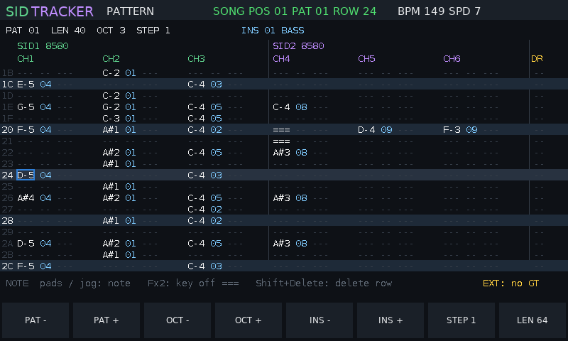
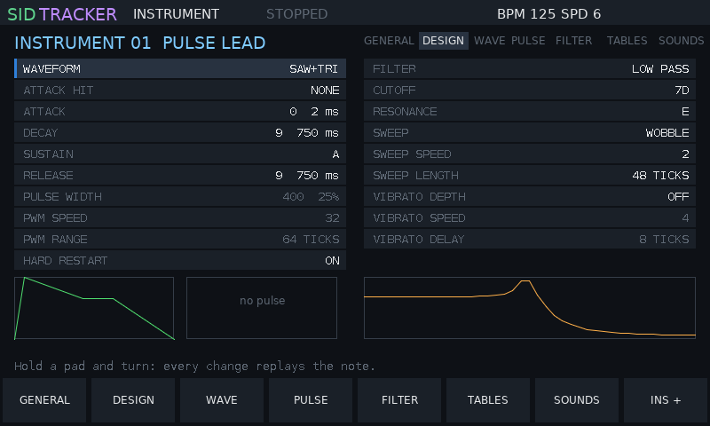
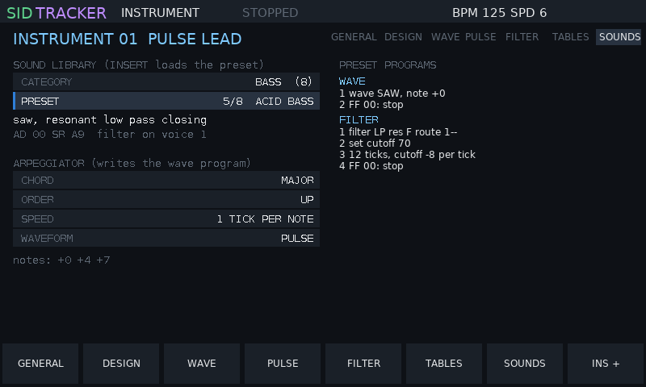
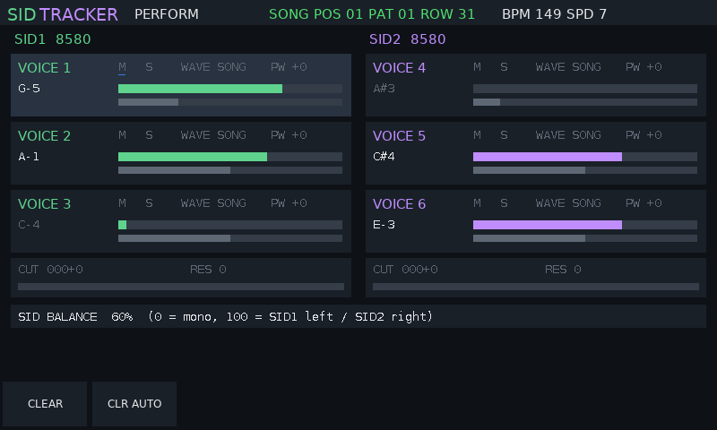
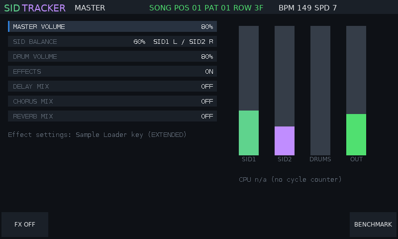
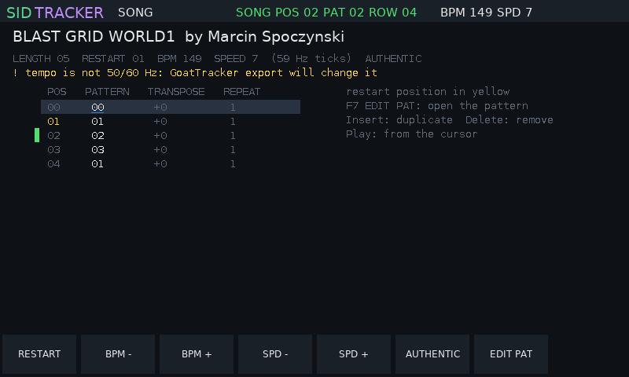
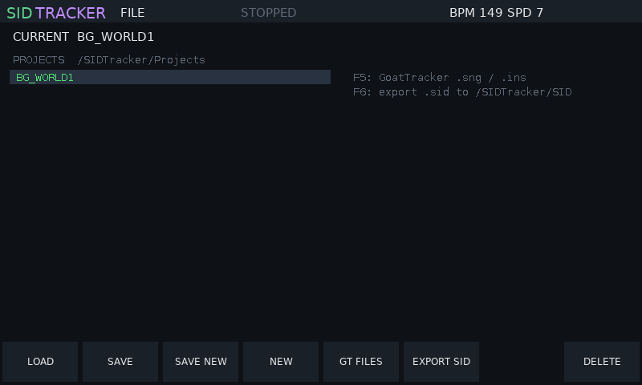

# SIDTracker

**A dual-SID music tracker for the original Polyend Tracker.** SIDTracker is
replacement firmware: it turns the Tracker into a Commodore 64 style music
machine with two emulated SID sound chips, six voices, a pattern editor,
an instrument designer, and export to GoatTracker and to real `.sid` files.



> **Disclaimer: use at your own risk.** SIDTracker is experimental,
> unofficial firmware, provided "as is" without warranty of any kind (see
> `LICENSE`). The authors are **not responsible for any loss of data, damage
> to your Tracker or SD card, or any other harm** caused by installing or
> using it. Back up your SD card before you start. Installing third-party
> firmware may affect your warranty. SIDTracker is an independent project,
> not affiliated with, endorsed by or supported by Polyend, and it contains
> no Polyend code.

## How it works

- **Firmware swap.** The Tracker has a built-in update loader that installs
  any firmware image (`.ptf` file) from the SD card's `/Firmware` folder.
  SIDTracker is such an image. Installing it replaces the stock firmware;
  the stock image stays on the card, so you can go back at any time (see
  [Back to stock](#back-to-stock)).
- **Two SID chips in software.** The SID (MOS 6581 / 8580) is the sound
  chip of the Commodore 64. SIDTracker emulates two of them, each with three
  voices: oscillators (triangle, saw, pulse, noise), ADSR envelopes, ring
  modulation, hard sync and the analogue filter. You choose 6581 or 8580
  per chip. The sound is computed live at 44.1 kHz.
- **A tracker drives the chips.** Like a C64 music routine, the player
  updates the SID registers about 50 times a second (one "tick"). A song is
  a list of patterns; a pattern has six tracks (tracks 1-3 play SID 1,
  tracks 4-6 SID 2), and each row holds a note, an instrument and a command.
- **Instruments are small programs.** As in GoatTracker, an instrument
  points into tables that run every tick: a wave table (waveform and pitch
  steps: arpeggios, drums), a pulse table (pulse-width sweeps) and a filter
  table (cutoff sweeps). You can edit the tables directly, design a sound
  with synth-style controls, or load one of 49 ready instruments.
- **Your music stays portable.** Songs are saved on the SD card. They can be
  exported to GoatTracker (`.sng` / `.ins`, and imported from it) and to
  `.sid` files with SIDTracker's own C64 play routine, which play in any SID
  player and on a real C64.

## Screenshots

| | |
|---|---|
|  **Instrument > DESIGN**: shape a sound with synth controls and hear every change |  **Instrument > SOUNDS**: 49 ready instruments and the arpeggiator |
|  **Perform**: live mute / solo, waveform, pulse width, filter |  **Master**: mixer, level meters, CPU load |
|  **Song**: the order list |  **File**: projects, GoatTracker, `.sid` export |

Screenshots from the desktop simulator. On the Tracker, Shift+Power saves
the screen to `/SIDTracker/Screenshots`.

## Install

You need the original Polyend Tracker and its SD card.

1. **Back up your SD card** (copy everything to your computer).
2. Unzip the release (`SIDTracker-<version>.zip`) onto the root of the SD
   card. It adds the firmware to `/Firmware` and example songs to
   `/SIDTracker`. Leave the stock image (`PolyendTracker_1.9.2.ptf`) in
   `/Firmware`.
3. On the stock firmware: **Config > Firmware update**, choose
   `PolyendTracSIDTRv064.ptf` and confirm. The Tracker restarts into
   SIDTracker.

### Updating SIDTracker

Copy the new `.ptf` into `/Firmware`, then in SIDTracker: **Config, F7
FIRMWARE**, turn the jog wheel to the new image, press **F8 INSTALL** twice.
Or put a text file `/Firmware/ot_restore.txt` on the card whose first line
is the image name: it is installed at the next power-on.

### Back to stock

- In SIDTracker: **Config, F7 FIRMWARE**, choose `PolyendTracker_1.9.2.ptf`,
  **F8 INSTALL** twice.
- If SIDTracker does not start: create `/Firmware/ot_restore.txt` containing
  the line `PolyendTracker_1.9.2.ptf`, insert the card and power on.

Image names must be exactly 24 characters and start with `PolyendTrac`; the
Tracker's loader ignores other names.

## Your first song in two minutes

1. **Pattern** key: the pattern screen. Press **Rec** (red cursor = edit mode).
2. Play notes on the **pads**; each note is written at the cursor, which
   moves down. **F3 / F4** change the octave, the **arrows** move the
   cursor, **Shift+Left/Right** jump between tracks.
3. **Instr. Params** key, **F7 SOUNDS**: pick a category and a preset with
   the jog wheel, **Insert** loads it into the current instrument. On the
   pattern screen, **F5 / F6** choose the instrument the pads write.
4. **Play** plays the song from the current pattern (**Shift+Play** loops
   the pattern). **Play** again stops.
5. **Song** key: add patterns to the order list. **File** key, **F2 SAVE**.

Instruments, tables and every command: [docs/commands.md](docs/commands.md).

## Keys

| Key | Function |
|---|---|
| Pattern | pattern editor (notes, instruments, commands; drum column) |
| Instr. Params | instrument: F1 GENERAL, F2 DESIGN, F3-F5 wave / pulse / filter tables, F6 all tables, F7 SOUNDS; F8 next instrument (Shift+F8 previous) |
| Performance | live controls; with Rec on while playing, changes are recorded |
| Song | order list and tempo; F7 EDIT PAT opens the pattern |
| Master | mixer: volume, balance, drums, effects, level meters, CPU (Shift+Master: benchmark) |
| Sample Loader | EXTENDED: effects, PCM drum kit, LFOs, voice pan |
| Config | SID models and clock, volume, THEME, song settings, F7 FIRMWARE update |
| File | load / save projects, F5 GoatTracker files, F6 export `.sid` |
| Help | key help on screen |
| Play / Rec | play / stop; edit mode |
| Jog wheel | changes the value under the cursor (Shift: coarse), otherwise scrolls |
| Insert / Delete / Copy | insert, delete (Shift: the whole row), copy / paste (Shift) |
| Shift+Power | screenshot; holding Power alone switches off |

## Features

- **Two SIDs, six voices**: 6581 / 8580 per chip, PAL / NTSC, stereo balance.
- **Tracker**: 128 patterns of up to 128 rows, order list with transpose and
  repeat, 16 commands (portamento, vibrato, tempo, filter, ...), hard restart.
- **Instruments**: GoatTracker-style wave / pulse / filter / speed tables, the
  DESIGN page, a library of 49 instruments, an arpeggiator.
- **GoatTracker**: `.sng` / `.ins` import and export; playback follows
  GoatTracker 2.
- **`.sid` export**: PSID files with SIDTracker's own 6502 player (two SIDs:
  the second chip at `$D420`).
- **Perform**: mute / solo and live overrides, recorded as automation.
- **Extended engine** (not part of the C64 or GoatTracker exports): PCM drum
  column with a 16-slot kit, delay / chorus / reverb, two LFOs, voice pan.
- **Themes**: SIDTracker, Commodore 64, Green Screen, Amber.

## Files on the SD card

| Folder | Contents |
|---|---|
| `/Firmware` | firmware images (stock, SIDTracker) |
| `/SIDTracker/Projects` | your songs (`.sidt`) and the examples |
| `/SIDTracker/GoatTracker` | `.sng` / `.ins` to import, GoatTracker exports |
| `/SIDTracker/SID` | `.sid` exports |
| `/SIDTracker/Kit` | your drum samples: `NNname.wav` goes into kit slot NN (01-16) |
| `/SIDTracker/Screenshots` | screenshots (`SHOTnnnn.bmp`) |
| `/SIDTracker/settings.txt` | volume and theme |

## Example songs

The release includes original demo songs (DUALDEMO, NIGHTDRIVE, PCMGROOVE,
FILTERS, CHIPMARCH) and the 13-song dual-SID soundtrack of the game *Blast
Grid 64* (`BG_*`, music by Marcin Spoczynski, used with permission), each
also as a `.sid` file.

## Status

Version 0.6.4. Confirmed on the Tracker: boot, SD card, playback, effects,
themes and firmware update; the full checklist is
[docs/hardware-test-plan.md](docs/hardware-test-plan.md). CPU use: about
37 % of the audio budget playing a song, more with effects
([docs/audio.md](docs/audio.md)).

## Building from source

Needs `arm-none-eabi-gcc` (newlib-nano), `g++`, Python 3; SDL2 for the
simulator, `qemu-system-arm` for the M4 benchmark.

```
make             # build/PolyendTracSIDTRv064.ptf
make check       # host tests, image check, simulator smoke run, player check
make sim         # desktop simulator (sim/README.md)
make release     # build/release/SIDTracker-<version>.zip: firmware + example songs
```

More: [plan](docs/PLAN.md) · [approach](docs/APPROACH.md) ·
[decisions](docs/DECISIONS.md) · [commands](docs/commands.md) ·
[project format](docs/project-format.md) · [.sid export](docs/sid-export.md) ·
[GoatTracker format](docs/goattracker-format.md) and
[mapping](docs/goattracker-mapping.md) · [Blast Grid import](docs/blastgrid-import.md) ·
[audio and CPU](docs/audio.md) · hardware: [overview](docs/hardware.md),
[firmware map](docs/firmware-map.md), [display](docs/display.md),
[input](docs/input.md), [storage](docs/storage.md).

## Licence

MIT, see `LICENSE`; the software is provided without warranty and the
disclaimer above applies. Third-party code keeps its own licence
(`src/platform/PROVENANCE.md`). No GPL code is used in the firmware. The
*Blast Grid 64* music is by Marcin Spoczynski.
