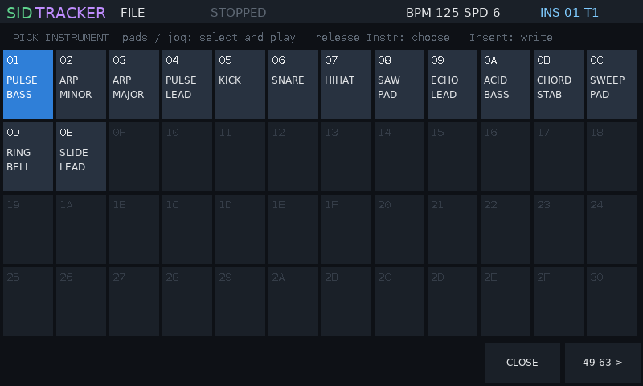

# SIDTracker

**A dual-SID music tracker for the original Polyend Tracker.** SIDTracker is
replacement firmware: it turns the Tracker into a Commodore 64 style music
machine with two emulated SID sound chips, six voices, a pattern editor, an
instrument designer and library, and export to real C64 `.sid` files and to
GoatTracker.


> **Disclaimer: use at your own risk.** SIDTracker is experimental,
> unofficial firmware, provided "as is" without warranty of any kind (see
> `LICENSE`). The authors are **not responsible for any loss of data, damage
> to your Tracker or SD card, or any other harm** caused by installing or
> using it. Back up your SD card before you start. Installing third-party
> firmware may affect your warranty. SIDTracker is an independent project,
> not affiliated with, endorsed by or supported by Polyend, and it contains
> no Polyend code.

Version 0.9.1. **New to SIDTracker? Read the [manual](docs/MANUAL.md)**
(also in the release zip as `MANUAL.md`).

## Downloads

From the [Releases](https://github.com/sandlbn/SidTracker/releases) page:

| File | Contents |
|---|---|
| `SIDTracker-0.9.1.zip` | everything for the SD card: the firmware, example songs and their `.sid` files, the instrument library, the manual |
| `SIDTracker-instruments-0.9.1.zip` | the instrument library only (65 instruments, GoatTracker `.ins`) |
| `SIDTracker-examples-0.9.1.zip` | the example songs only (`.sidt` and C64 `.sid`) |

Each zip unpacks onto the root of the SD card.

## How it works

- **Firmware swap.** The Tracker has a built-in update loader that installs
  any firmware image (`.ptf` file) from the SD card's `/Firmware` folder.
  SIDTracker is such an image. Installing it replaces the stock firmware;
  the stock image stays on the card, so you can go back at any time (see
  [Back to stock](#back-to-stock)).
- **Two SID chips in software.** The SID (MOS 6581 / 8580) is the sound
  chip of the Commodore 64. SIDTracker emulates two of them, each with three
  voices: oscillators (triangle, saw, pulse, noise), ADSR envelopes, ring
  modulation, hard sync and the analogue filter. You choose 6581 or 8580
  per chip. The sound is computed live at 44.1 kHz.
- **A tracker drives the chips.** Like a C64 music routine, the player
  updates the SID registers about 50 times a second (one "tick"). A song is
  a list of patterns; a pattern has six tracks (tracks 1-3 play SID 1,
  tracks 4-6 SID 2), and each row holds a note, an instrument and a command.
- **Instruments are small programs.** As in GoatTracker, an instrument
  points into tables that run every tick: a wave table (waveform and pitch
  steps: arpeggios, drums), a pulse table (pulse-width sweeps) and a filter
  table (cutoff sweeps). You rarely need to touch them: shape a sound with
  synth-style controls, try presets from the library, or let the
  randomiser suggest one.
- **Your music stays portable.** Songs are saved on the SD card. They export
  to `.sid` files with SIDTracker's own C64 play routine, which play in any
  SID player and on a real C64, and to GoatTracker (`.sng` / `.ins`, also
  imported).

## Screenshots

| | |
|---|---|
|  **Instrument > DESIGN**: synth controls on pages of columns; every change is heard on the pads |  **Instrument > SOUNDS**: turn the jog to try presets or the instruments on the card, CANCEL / KEEP |
|  **Hold Instr**: pick an instrument on any screen; the pads play each slot |  **Master**: track mixer with meters (hold a track button, turn the jog) |
|  **Perform**: live mute / solo, waveform, pulse width, filter |  **Song**: the order list, tempo, multispeed |
|  **File**: projects, GoatTracker, `.sid` export, SID player | |

Screenshots from the desktop simulator (`make screenshots`). On the Tracker,
Shift+Power saves the screen to `/SIDTracker/Screenshots`.

## Install

You need the original Polyend Tracker and its SD card.

1. **Back up your SD card** (copy everything to your computer).
2. Unzip `SIDTracker-0.9.1.zip` onto the root of the SD card. It adds the
   firmware to `/Firmware`, and songs and instruments to `/SIDTracker`. Leave
   the stock image (`PolyendTracker_1.9.2.ptf`) in `/Firmware`.
3. On the stock firmware: **Config > Firmware update**, choose
   `PolyendTracSIDTRv091.ptf` and confirm. The Tracker restarts into
   SIDTracker.

### Updating SIDTracker

Copy the new `.ptf` into `/Firmware`, then in SIDTracker: **Config**, the
**FIRMWARE UPDATE** row, turn the jog wheel to the new image, press
**INSTALL** twice. Or put a text file `/Firmware/ot_restore.txt` on the card
whose first line is the image name: it is installed at the next power-on.

### Back to stock

- In SIDTracker: **Config, FIRMWARE UPDATE**, choose
  `PolyendTracker_1.9.2.ptf`, **INSTALL** twice.
- If SIDTracker does not start: create `/Firmware/ot_restore.txt` containing
  the line `PolyendTracker_1.9.2.ptf`, insert the card and power on.

Image names must be exactly 24 characters and start with `PolyendTrac`; the
Tracker's loader ignores other names.

## Your first song in two minutes

The eight buttons under the screen do what the label above each one says;
this README names them by their label.

1. **Pattern** key: the pattern screen. Press **Rec** (edit mode).
2. Play notes on the **pads**: each note is written at the cursor, which
   moves down. **OCT - / OCT +** change the octave, the **arrows** move the
   cursor, **Shift+Left/Right** jump between tracks.
3. **Instruments, the stock way**: press **Instr** to reach the instrument
   column; now each pad is an instrument (1-48) and writes it into the step.
   **Hold Instr** for the full list (63) on any screen.
4. **Instr. Params** key, press it until **SOUNDS**, press Down to PRESET and
   turn the jog: every preset plays on the pads at once; **KEEP** keeps it,
   **CANCEL** goes back. The CARD category lists the instrument library on
   the SD card.
5. **Play** plays the song (**Shift+Play** loops the pattern).
6. **Song** key: add patterns to the order list. **File** key, **SAVE NEW**:
   type a name on the pads.

The [manual](docs/MANUAL.md) covers every screen; instruments, tables and
every command are in [docs/commands.md](docs/commands.md).

## Keys

| Key | Function |
|---|---|
| Pattern | pattern editor (notes, instruments, commands; drum column). In the instrument column the pads are instruments 1-48; Shift + the buttons below mutes tracks |
| Instr. Params | instrument; press again for the next page (GENERAL, DESIGN, WAVE, PULSE, FILTER, TABLES, SOUNDS). GENERAL: ADSR, INIT / COPY / PASTE / SAVE; DESIGN: synth columns, Insert = variation, Shift+Insert = random sound; tables: INS ROW / DEL ROW / POINT HERE / USERS / PACK |
| hold Instr | instrument picker on any screen |
| Performance | live controls; with Rec on while playing, changes are recorded |
| Song | order list and tempo; EDIT PAT opens the pattern, MULTI multispeed |
| Master | mixer: TRK 1-6, DRUMS, MASTER; hold one + jog = level, tap = mute, Shift+tap = solo; Master again: balance, effects, CPU |
| Sample Loader | Extended: effects, PCM drum kit, LFOs, voice pan |
| Config | SID models and clock, volume, THEME, ONE SID ON BOTH SIDES, MIDI, song settings, firmware update |
| File | load / save projects, GT FILES (GoatTracker), EXPORT SID, SID PLAYER |
| Help | key help on screen |
| Play / Rec | play / stop; edit mode |
| Shift+Rec / Shift+Sample Recorder | undo / redo |
| Jog wheel | changes the value under the cursor (Shift: coarse), otherwise scrolls |
| Insert / Delete / Copy | insert, delete (Shift: remove), copy / paste (Shift) |
| Shift+Power | screenshot; holding Power alone switches off |

Questions (delete, overwrite, export) show two buttons: the answer and
**CANCEL**.

## Features

- **Two SIDs, six voices**: 6581 / 8580 per chip, PAL / NTSC, stereo balance;
  **one SID on both sides** for one-SID songs and tunes.
- **Tracker**: 128 patterns of up to 128 rows, order list with transpose and
  repeat, 16 commands (portamento, vibrato, tempo, filter, ...), hard restart,
  multispeed x1-x8, undo / redo.
- **Instruments**: every new instrument sounds at once (init patch); ADSR on
  GENERAL; the DESIGN page (synth controls that write the tables); a
  randomiser; GoatTracker-style tables with insert / delete rows that keep
  every reference.
- **Sound library**: 49 built-in presets and an arpeggiator, plus a
  65-instrument library on the card (`/SIDTracker/Instruments`, GoatTracker
  `.ins`); try any of them live, keep or cancel; save your own.
- **`.sid` export**: PSID files with SIDTracker's own 6502 player (two SIDs:
  the second chip at `$D420`), checked frame by frame against the tracker.
- **GoatTracker**: `.sng` / `.ins` import and export; playback follows
  GoatTracker 2.
- **SID player**: plays C64 `.sid` files (PSID, one or two SIDs, subtunes)
  from anywhere on the card, e.g. the HVSC collection.
- **Perform**: mute / solo and live overrides, recorded as automation.
- **Mixer**: a level per track (Extended), drums, master; meters.
- **MIDI and real SIDs**: notes and CC from a keyboard, MIDI clock in and out,
  and ASID output to drive real SID chips (e.g. a USBSID-Pico) over DIN or
  USB; [SIDLink](tools/sidlink/README.md) bridges the Tracker to a
  USBSID-Pico with a Raspberry Pi Pico 2 and a powered hub.
- **Extended engine** (not part of the C64 or GoatTracker exports): PCM drum
  column with a 16-slot kit, delay / chorus / reverb, two LFOs, voice pan,
  track levels.
- **Themes**: SIDTracker, Commodore 64, Green Screen, Amber.

## Files on the SD card

| Folder | Contents |
|---|---|
| `/Firmware` | firmware images (stock, SIDTracker) |
| `/SIDTracker/Projects` | your songs (`.sidt`) and the examples |
| `/SIDTracker/Instruments` | instrument library (`.ins`): stock folders and `User` |
| `/SIDTracker/SID` | `.sid` exports and the examples as `.sid` |
| `/SIDTracker/GoatTracker` | `.sng` / `.ins` to import, GoatTracker exports |
| `/SIDTracker/Kit` | your drum samples: `NNname.wav` goes into kit slot NN (01-16) |
| `/SIDTracker/Screenshots` | screenshots (`SHOTnnnn.bmp`) |
| `/SIDTracker/settings.txt` | volume, theme, MIDI, one-SID copy |

## Example songs

The release includes original songs, each also as a `.sid` file:

- DUALDEMO, NIGHTDRIVE, PCMGROOVE, FILTERS, CHIPMARCH;
- HYPERARP and SILKSWEEP, written for multispeed x4 / x2;
- three demoscene tunes made from the instrument library: CRACKINTRO (a
  one-SID cracktro), RASTERBARS (a two-SID main part) and ENDSCROLL (a slow
  two-SID end part);
- the 13-song dual-SID soundtrack of the game *Blast Grid 64* (`BG_*`, music
  by Marcin Spoczynski, used with permission).

## Building from source

Needs `arm-none-eabi-gcc` (newlib-nano), `g++` and Python 3.

```
make           # the firmware image: build/PolyendTracSIDTRv091.ptf
make release   # the release zip: firmware, songs, instruments, manual
```

## Licence

MIT, see `LICENSE`; the software is provided without warranty and the
disclaimer above applies. Third-party code keeps its own licence
(`src/platform/PROVENANCE.md`). No GPL code is used in the firmware. The
*Blast Grid 64* music is by Marcin Spoczynski.
